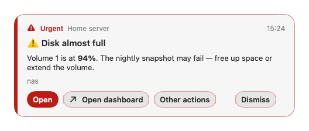
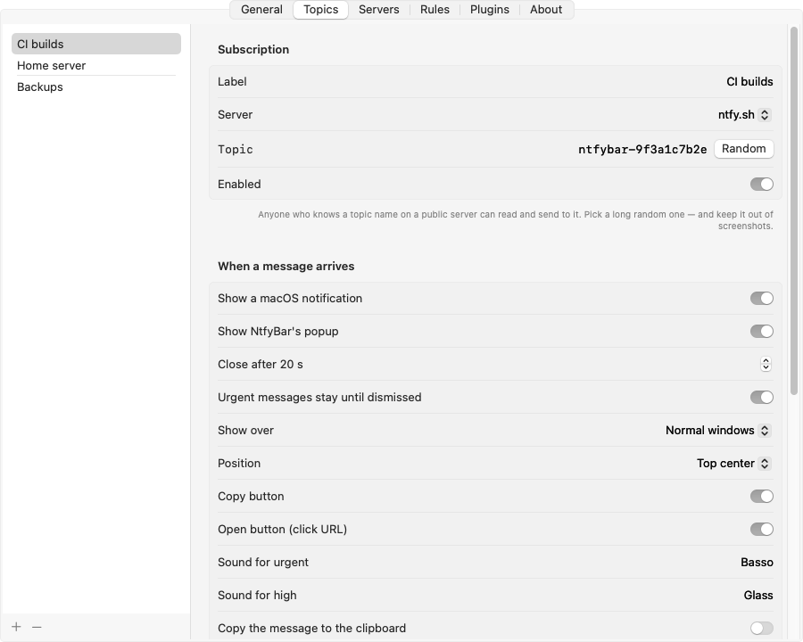
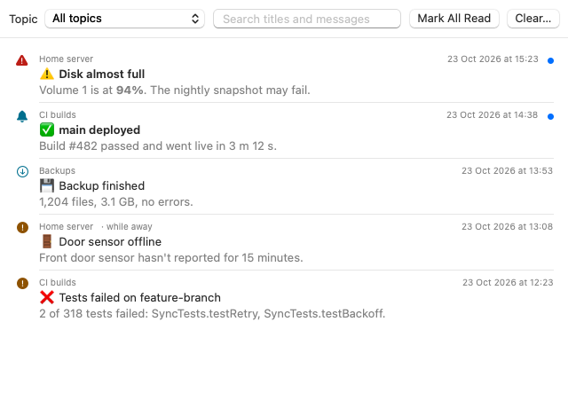

<div align="center">


# NtfyBar

**A native macOS menu-bar client for [ntfy](https://ntfy.sh) — notifications, popups that don't get missed, rules, commands and sandboxed plugins, for ntfy.sh or your own server.**

[](#requirements)
[](Package.swift)
[](https://github.com/roypadina/NtfyBar/actions/workflows/ci.yml)
[](https://github.com/roypadina/NtfyBar/releases)
[](#install)
[](https://apps.roypadina.synology.me/apps/ntfybar/)
[](LICENSE)
[](https://ko-fi.com/roypadina)
[](CONTRIBUTING.md)



</div>

ntfy lets any script, server or service send you a push notification with one HTTP request.
NtfyBar puts those messages on your Mac: it subscribes to your topics, keeps a searchable history,
and lets each topic decide what happens — a normal notification, a popup that stays until you act,
a copy to the clipboard, a shell command, or rules and plugins.

## Features

- **Topics on ntfy.sh or your own server** — several servers, with username/password or access-token sign-in. Live streaming with automatic reconnect; messages sent while your Mac was asleep or offline are fetched and summed up in one notification instead of a flood.
- **Per topic, choose what happens:** macOS notification · NtfyBar popup · copy to clipboard · run your own shell command · any combination.
- **Popups that don't get missed** — float above your windows (optionally above full-screen apps) without stealing focus, stack neatly, show priority as colour *and* icon *and* word, render markdown, and carry the message's own action buttons (open a link, send an HTTP request). Urgent ones stay until you dismiss them.
- **Rules** — conditions (priority, title/message text or regex, tags, JSON, …) and actions (popup, copy, open a URL, run a command or Shortcut, publish a reply, play a sound, skip the topic defaults). Edit them in Settings or in `rules.json`.
- **Plugins** — JavaScript conditions, actions and popups in a sandbox with permissions you approve one by one ([marketplace](https://github.com/roypadina/NtfyBar-Plugins)).
- **History** — every message, searchable, per topic, with read/unread.
- **Calm by design** — flood guard (a burst of messages becomes one notice and one counting popup), pause for 15 min / 1 h / until resumed, quiet hours for anything NtfyBar sends.
- **Private** — no account, no telemetry, no update checks; everything stays on your Mac.

<p align="center">
  
  
</p>

## Requirements

- macOS 14 Sonoma or later
- Apple Silicon and Intel (universal app)
- An ntfy topic — on [ntfy.sh](https://ntfy.sh) (free, no account) or a [self-hosted](https://docs.ntfy.sh/install/) server

## Install

### Homebrew

```sh
brew install --cask roypadina/tap/ntfybar
```

NtfyBar is ad-hoc signed (not notarized), so on first launch macOS may block it. Right-click
NtfyBar in `/Applications` and choose **Open**, or run once:

```sh
xattr -dr com.apple.quarantine "/Applications/NtfyBar.app"
```

### Build from source

Needs Xcode 16 or later (Swift 6).

```sh
git clone https://github.com/roypadina/NtfyBar.git
cd NtfyBar
swift test
Scripts/package_app.sh          # builds dist/NtfyBar.app
```

Move `dist/NtfyBar.app` to `/Applications` and open it from there. More in the
[wiki](https://github.com/roypadina/NtfyBar/wiki/Building-from-source).

## Usage

1. Click the bell in the menu bar → **Settings… › Topics › +**.
2. Give the topic a label, pick the server and enter the topic name — the same one you use in the
   ntfy phone app or in your scripts. **Random** makes an unguessable one.
3. Choose what happens when a message arrives, then **Save** and **Send Test Message**.
4. Send yourself something:

   ```sh
   curl -H "Title: Backup done" -H "Tags: white_check_mark" -d "3.1 GB, no errors" ntfy.sh/<your topic>
   ```

The menu shows the connection state, your last messages (unread count next to the bell), **Mark
All Read**, **Pause Notifications** and **History…**.

### Popup keys

Once you click into a popup: **Return** = the highlighted button, **1**–**3** = the first buttons,
**⌘C** = copy the message, **Esc** = dismiss. Buttons that come from the message itself show ↗ (opens
a link) or ⇄ (sends a request) and their target when you hover.

### Commands

A topic (or a rule) can run a shell command with `/bin/zsh` in your home folder. The message is
never pasted into the command — it arrives in environment variables and on stdin:

| Variable | Contains |
|---|---|
| `NTFY_MESSAGE`, `NTFY_TITLE` | message text and title |
| `NTFY_PRIORITY`, `NTFY_TAGS`, `NTFY_CLICK` | priority 1–5, comma-separated tags, click URL |
| `NTFY_ID`, `NTFY_TIME`, `NTFY_JSON` | message id, unix time, the full message JSON |
| `NTFY_TOPIC`, `NTFY_TOPIC_LABEL` | the topic name and your label |

```sh
say "$NTFY_TITLE"                                  # speak the title
jq -r .message <<< "$NTFY_JSON" >> ~/ntfy.log      # append the text to a log
```

Always quote the variables, and never paste them into code that another interpreter runs
(`eval`, `sh -c "…$NTFY_MESSAGE…"`, `osascript -e "…"`) — anyone who can post to your topic
controls that text. Commands time out after 30 s by default and run one at a time per topic.

### Rules and plugins

**Settings › Rules** — every enabled rule whose conditions match runs, top to bottom. A rule can
be limited to some topics and can skip the topic's own notification/popup. **Settings › Plugins**
adds conditions and actions from plugins; see [Plugins](#plugins).

## Plugins

Plugins are small JavaScript packages from the [NtfyBar-Plugins](https://github.com/roypadina/NtfyBar-Plugins)
marketplace, another marketplace you add, or a local folder. These ship with NtfyBar (off until you
enable them in Settings › Plugins, then use them in a rule):

| Plugin | What it adds |
|---|---|
| **Alert Card** | A big card with **Acknowledge** and **Snooze N min** (the alert comes back later, even if NtfyBar was quit), optional auto-dismiss, position and "over full-screen apps" of your choice, and a "3rd time today" badge. |
| **Repeat & Burst** | Conditions "not seen recently" (calm a flapping alert: only the first of a series) and "burst" (≥ N messages in M minutes). |
| **Extract** | Copy the part of a message a regex matches (a login code, an IP), or open it in a link template (a PR number → its page). |
| **JSON Fields** | Match JSON messages by a field's value or by a change since the previous message; show a JSON message as a table. |
| **ACK Button** | A popup whose ACK button replies to the sender's topic. |

More in the marketplace, e.g. **Time Window** (only between 09:00–18:00 on weekdays) and **Reply
Buttons** (up to three buttons that each send a reply — two-way home automation).

A plugin sees only the message that triggered it — never your settings; topic names and server
addresses are hidden from it (best-effort, see Privacy) — and can only do what its permissions allow, after you agreed. Each permission can be
switched off later. Marketplace installs are checked file by file against published SHA-256
checksums before anything is written. Plugins can **never** run commands, use the network, read
your clipboard or files, change settings or subscribe to topics. Write your own:
[authoring guide](https://github.com/roypadina/NtfyBar-Plugins/blob/main/docs/authoring.md).

<p align="center"></p>

## Permissions

- **Notifications** — asked on first launch. Turn on or off in System Settings › Notifications › NtfyBar.
- **Local network** — macOS asks the first time you use a server on your home network.

NtfyBar needs no Accessibility, Full Disk or other special access.

## Limitations

- Not notarized (ad-hoc signed): see the first-launch note under [Install](#homebrew).
- Attachments are shown as a link; NtfyBar doesn't download or preview them.
- ntfy's Android `broadcast` actions don't apply on a Mac and are hidden.
- A command that starts background processes: on timeout NtfyBar stops the shell, not its children.
- Messages are kept up to the server's cache window (12 h on ntfy.sh); NtfyBar can only catch up on what the server still has.

## Privacy

- **Local only.** Settings live in `~/Library/Application Support/NtfyBar/` (folder readable only by you, files mode 600): `config.json` (topics, servers and their credentials), `rules.json`, `state.json` and `history.sqlite`. Message history is stored **unencrypted** there.
- **Topics are passwords.** On a public server anyone who knows a topic name can read and post to it. Use long random names (Settings has a **Random** button), and see the [ntfy docs](https://docs.ntfy.sh/publish/#message-caching) — ntfy.sh keeps messages for up to 12 hours.
- **No telemetry, no analytics, no update checks.** NtfyBar connects only to the servers you configure, and to plugin marketplaces when you press Refresh or Install.
- Topic names appear only in the topic editor and the config file; menus, popups, logs and plugins see your labels.
- Plugins: see [Plugins](#plugins) for what they can and can't do. Hiding topic names and server addresses from plugins is best-effort (text replacement — a sender who encodes them defeats it), and a plugin allowed to open links can send message text to a website in the URL. Grant permissions only to plugins you trust.

## Roadmap

Ideas, not promises: HTML popups for plugins (in a locked-down web view), a `network` permission
limited to listed hosts, attachment previews, credentials in the Keychain, a schedule for popups,
WebSocket transport. [Open an issue](https://github.com/roypadina/NtfyBar/issues) to vote or suggest.

## Uninstall

```sh
brew uninstall --cask ntfybar
```

Then remove its data if you like: `~/Library/Application Support/NtfyBar/`
(`brew uninstall --zap --cask ntfybar` does this for you). If you enabled **Launch at login**,
switch it off first in Settings › General.

## Feature requests and contributions

Have an idea for NtfyBar? [Request a feature](https://github.com/roypadina/NtfyBar/issues/new?template=feature_request.yml) and say what you're trying to do; that matters more than the exact feature. Found a bug? [Report it](https://github.com/roypadina/NtfyBar/issues/new?template=bug_report.yml).

Code is welcome too: small, focused pull requests, and an issue first for anything bigger. See [CONTRIBUTING.md](CONTRIBUTING.md).

Tipped on [Ko-fi](https://ko-fi.com/roypadina)? Add your Ko-fi name to the request and it goes to the front of my queue. It's a thank-you, not a purchase: no promise on what ships or when.

## More Mac apps by Roy

Free, open-source Mac menu-bar apps and terminal tools, all on one site: **[apps.roypadina.synology.me](https://apps.roypadina.synology.me/)**.

- [MaccyPlus](https://apps.roypadina.synology.me/apps/maccyplus/) — Maccy, plus automation: rules, hotkeys, plugins and a CLI for AI agents.
- [MeetAlert](https://apps.roypadina.synology.me/apps/meetalert/) — Meeting alerts you can't miss: a popup that stays, a phone push that escalates.
- [SmartHiddenBar](https://apps.roypadina.synology.me/apps/smarthiddenbar/) — Hide the menu bar clutter. Reach it in one click.
- [Window Organizer](https://apps.roypadina.synology.me/apps/window-organizer/) — Clear the desk in one keystroke.

## Support

NtfyBar is free and open source. If it saves you time, a coffee keeps the next one coming:

[](https://ko-fi.com/roypadina)

## License

[MIT](LICENSE) © Roy Padina. ntfy tag emoji list from [ntfy](https://github.com/binwiederhier/ntfy)
(Apache-2.0), based on [gemoji](https://github.com/github/gemoji) (MIT). NtfyBar is not affiliated with ntfy.
